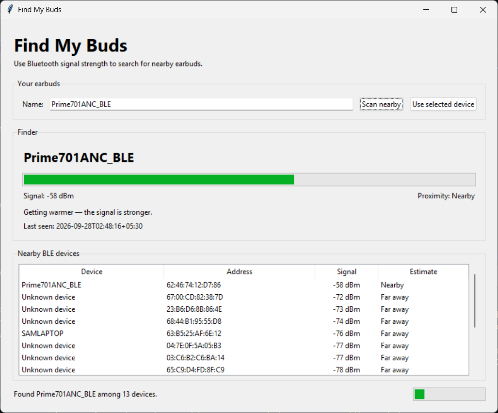

# Find My Buds

A small Windows desktop app that uses Bluetooth Low Energy (BLE) signal strength
to help find nearby earbuds. It listens continuously, remembers the selected
earbuds, reports broad proximity, and tells you in real time whether you are
getting warmer or colder as you walk around.

## What it can and cannot do

Find My Buds uses RSSI (received signal strength), not GPS. RSSI changes with
walls, furniture, your body, radio interference, and the earbud model, so the
distance labels are estimates.

Many earbuds stop advertising when their charging case is closed. No Bluetooth
scanner can find them in that state unless the hardware provides a dedicated
finding network such as Apple Find My, Google Find Hub, or Samsung SmartThings
Find.

## Requirements

- Windows 10 or 11
- Python 3.10 or newer
- Bluetooth enabled
- Earbuds that advertise over BLE

## Install and run

From PowerShell in this directory:

```powershell
python -m venv .venv
.venv\Scripts\Activate.ps1
python -m pip install -r requirements.txt
python find_earbuds.py
```

If PowerShell blocks activation, the virtual environment is optional; install
with `python -m pip install -r requirements.txt` and run the app directly.

## Using the app

1. Open the earbud case or put the earbuds in pairing mode.
2. Select **Start scanning**. The app keeps listening until you select
   **Stop scanning**; there is no scan duration or interval to configure.
3. Select the earbuds in the device table and choose **Use selected device**
   (or double-click the row).
4. Walk around slowly. The Finder panel updates twice a second.
5. Follow the signal value and warmer/colder message. A value around `-40 dBm`
   is strong, while a value around `-90 dBm` is weak.

You can also type part of the Bluetooth device name and press Enter, which
applies the name and starts scanning.

### How the earbuds are matched

Once you choose **Use selected device**, the app matches by saved address
first. Many earbuds change their Bluetooth address over time, so it falls back
to the exact saved name. Partial names are only used when you typed a name and
no address is saved, which avoids latching onto a neighbour's similarly named
device. If several devices match equally, the strongest signal is used.

### Continuous scanning and smoothing

The app receives every Bluetooth advertisement as it arrives. Each device's
signal is the **median of its readings over the last 5 seconds**, so a single
noisy reading does not move the display. The Finder panel shows how many
readings the value is based on.

The warmer/colder message compares the current smoothed signal with the one
from up to 6 seconds earlier (once at least 3 seconds of history exist), and
ignores changes smaller than 5 dBm. A device that has not been heard for 12
seconds is dropped from the list; if it is your target, the Finder panel shows
"Not detected" and the trend restarts when it returns.

The device list updates in place so your selection is kept, and is re-sorted by
signal every few seconds.

If scanning fails (for example Bluetooth is off), the error is shown in the
status bar and scanning stops until you start it again.

The saved target (including its Bluetooth address) and last-seen time are
stored in plain text in `.find_my_buds.json` in your home folder. No scan data
is sent over the internet. If that file is damaged it is kept as
`.find_my_buds.json.corrupt` and the app starts with defaults.

## Live Bluetooth test

A manual scan successfully detected `Prime701ANC_BLE` among 13 nearby BLE
devices. The `-58 dBm` signal was classified as **Nearby**, and a second scan
reported that the signal was getting warmer.



## Run tests

```powershell
python -m unittest discover -s tests -v
```

## Troubleshooting

- **Nothing appears:** Verify Bluetooth is on, open the charging case, and try
  pairing mode.
- **The earbuds are connected but absent:** Some devices use Classic Bluetooth
  for audio and do not emit discoverable BLE advertisements continuously.
- **The signal jumps around:** Rescan from the same position and use broad trends
  rather than treating RSSI as an exact distance.
- **Access or scanning error:** Check Windows Bluetooth/privacy permissions and
  close other tools that may be controlling the Bluetooth adapter.
